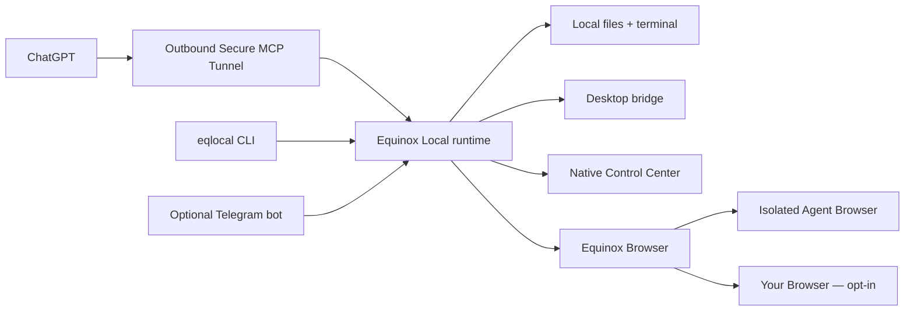

<div align="center">
  

  <p>A local-first bridge that lets ChatGPT work with your files, terminal, browser and desktop through a native Control Center and explicit user permissions.</p>

  [](https://local.sametbasbug.dev/install/)
  [](https://chromewebstore.google.com/detail/equinox-browser/npdneefcobilfkjlihghjgjnknenhfoj)
  [](https://github.com/sametbasbug/equinox-local/actions/workflows/ci.yml)
  [](LICENSE)
  

  **[Get started](https://local.sametbasbug.dev/install/)** · **[Features](#what-you-can-do)** · **[Installation](#install-equinox-local)** · **[Documentation](#documentation)** · **[Contribute](CONTRIBUTING.md)**
</div>

---

## What you can do

Equinox Local brings ChatGPT to your computer through an **outbound OpenAI Secure MCP Tunnel**. The native Control Center stays on your machine, and [Equinox Browser](https://chromewebstore.google.com/detail/equinox-browser/npdneefcobilfkjlihghjgjnknenhfoj) provides the only supported browser-automation bridge.

| Capability | What it does |
| --- | --- |
| **🗂️ Projects, files & terminal** | Explore and edit local files, work in repositories, run platform-appropriate shell commands, and manage bounded processes with your account's permissions. |
| **🌐 Two browser contexts** | Use a separately isolated **Agent Browser** by default, or explicitly allow **Your Browser** (your signed-in Chrome profile). No silent context switching. |
| **🖥️ Desktop automation** | Interact with approved desktop apps through the platform's native desktop bridge: Peekaboo on macOS and pinned Microsoft winapp on Windows. |
| **🔁 Long-running tasks** | Task Capsules, Auto Continue, Turn Budget and Fresh Chat Resume preserve checkpoints and support intentional continuation across ChatGPT conversations. |
| **💬 Optional Telegram** | Pair your own private bot, create or switch tasks, send messages to a chosen bound ChatGPT conversation, and receive task updates. |
| **⌨️ Agent CLI (`eqlocal`)** | Use the same authenticated local capabilities from a JSON-first terminal client: inspect status/tools, manage Task Capsules, and start/send/read/wait for task-bound chats. |
| **🛠️ Native Control Center** | Configure access, review status and diagnostics, manage tasks, use Emergency Stop, and install verified updates on macOS or Windows. |
| **🔐 Signed Main delivery** | Receive verified, source-SHA-specific native builds for four platform/architecture targets. The installed runtime and extension have separate update channels. |

> [!IMPORTANT]
> **Local-first is not a sandbox.** Enabling Terminal allows an agent to run commands with the permissions of your signed-in operating-system account, potentially outside configured project folders. Review the [security model](docs/security-model.md) and use Agent Access controls or Emergency Stop when appropriate.

## Install Equinox Local

### macOS — Apple silicon & Intel

Run as your normal user, **without `sudo`**:

```bash
curl -fsSL https://local.sametbasbug.dev/downloads/updates/install-equinox-local.sh | /bin/bash
```

### Windows — ARM64 & x64

Run in **native 64-bit Windows PowerShell** as your normal user (**no Administrator elevation**):

```powershell
irm https://local.sametbasbug.dev/downloads/updates/install-equinox-local.ps1 | iex
```

You can [inspect the official PowerShell installer](https://github.com/sametbasbug/equinox-local/blob/main/scripts/install-equinox-local.ps1) before running it, or follow the [Windows installation guide](https://local.sametbasbug.dev/install/).

On macOS, use **Start at login** in the Equinox Local menu bar to enable or disable automatic launch at the next sign-in (the current session continues running). Windows has the same option in its tray menu.

Both installers download the **latest production-signed Main** for your platform, validate its signed identity and archive, and install only the product's program files. You do **not** need to preinstall Node, Git, Homebrew or compiler tools. Running the installer again is also the supported repair/reinstall path; existing user settings and personal data are preserved. The **Control Center Update** action uses the same signed OS installer; no separate Stable/Main enrollment is required.

After installing, open **Setup** to configure an OpenAI Secure MCP Tunnel and its restricted runtime key. Then open **ChatGPT → Plugins**, add your own custom MCP plugin using **Tunnel**, and install/enable Equinox Browser in Chrome. The onboarding flow checks the connection and access settings.

**Requirements:** macOS or Windows on ARM64/x64, Chrome, internet access, and a ChatGPT account. **Free and paid ChatGPT users can add custom MCP plugins directly from Plugins — no developer mode, extra setting or paid ChatGPT plan is required.** Equinox Local also needs a Secure MCP Tunnel and a restricted OpenAI Platform runtime key to connect. Telegram is optional. Read the [tunnel](docs/tunnel.md) and [browser setup](docs/browser.md) guides.

### Equinox Browser is installed separately

Get [Equinox Browser from the Chrome Web Store](https://chromewebstore.google.com/detail/equinox-browser/npdneefcobilfkjlihghjgjnknenhfoj). Consent and Browser Control are explicit per browser context. Chrome Web Store manages extension updates; **Equinox Local never sideloads or overwrites the extension**.

## Optional plugins

The native **Plugins** workspace offers curated integrations. **Equinox Brain**, powered by [Avenox Beyin](https://github.com/avenoxai/avenoxbeyin) (MIT), is optional: create a new vault or connect an existing V3 vault. Python 3.11+ is required for installation and memory access. The Brain settings section appears in Control Center after connection; disconnecting preserves the vault.

The install/connect dialog enables recommended memory features by default with an explicit, deselectable consent switch. Confirming prepares the verified local engine and index, then use `brain_search` through the integrations capability. Search currently supports upstream V3.17.0 and returns bounded, source-backed results excluding private and untrusted notes. Refresh the index manually as needed. `brain_read` reads an exact current record by ID under the same privacy gates. With agent writing enabled, use `brain_create` (new internal notes), `brain_edit` (unique body anchor with a current source hash), `brain_task_create` / `brain_task_update` (shared tasks with revision checks), and `brain_receipt` (source-backed work records). Potential secrets detected by the upstream filter are refused without changing the shared vault preferences. Brain settings can open the connected vault and explicitly load or apply upstream normal, economical and manual profiles; these shared settings also affect other agents using the vault. The on-demand engine diagnostics check Python, the pinned package, vault binding, SQLite health and preferences. Optional native Assistant and Your Browser index refresh follow observed conversation/turn activity and the shared refresh cadence without collecting prompts or transcripts. Each scope can be disabled independently; existing permission choices are preserved; Your Browser uses the existing Equinox Browser turn resolver, respects explicit pins, and never falls back to Agent Browser. `brain_context` provides a profile-budgeted, source-backed context pack when invoked by the agent; manual mode abstains while explicit search remains available. In native Assistant, the optional Brain context review lets the user search a topic, select source excerpts and explicitly append them to the unchanged draft; the user still sends the message. This is not a hidden model hook. See [the Brain usage guide](docs/brain.md). Only reviewed upstream versions are supported; upgrade shared vaults using upstream instructions and reconnect.

## Agent CLI

The `eqlocal` command communicates with the **already-running** Equinox Local process over a private, authenticated local IPC bridge. It does not start a second AI agent or run a second web server. Managed macOS/Windows installations provision the CLI; macOS Factory/source-checkout runtimes provision a launcher for their existing local runtime too.

```bash
# Inspect your connected runtime and its tools
eqlocal status
eqlocal tools list

# Read the complete CLI interface
eqlocal --help
```

The CLI also supports Task Capsule operations and guarded task-bound ChatGPT messaging. See the [CLI guide](docs/cli.md) for commands, JSON argument handling, and platform-specific shell behavior.

## How it works



- **Local management:** Since 7.0.0, the existing Control Center interface is packaged inside the native Electron application. Electron reads Control Center data through the existing private, authenticated local IPC bridge. The current 7.1.0 implementation does not start an HTTP dashboard or management listener; older rollback releases retain their own legacy behavior. Signed Main health gates use authenticated IPC. Runtime capabilities remain subject to configured access and product guards.
- **Separate browser identities:** Agent Browser and Your Browser maintain independent profiles and consent. Your personal Chrome is never an implicit fallback.
- **Resumable actions:** Task continuation preserves state without automatically repeating a chat send whose result is uncertain.
- **One signed Main channel:** A completed four-target Main build is published as immutable source-SHA native artifacts and an Ed25519-signed latest selector. The native installer verifies this before replacing program files. Main presentation version and exact source commit are distinct; changes can ship without a new numbered GitHub Release.
- **Independent extension lifecycle:** the Chrome Web Store owns Equinox Browser review, publication and automatic updates.

## Documentation

| Guide | What you'll find |
| --- | --- |
| [Install & connect](https://local.sametbasbug.dev/install/) · [Tunnel](docs/tunnel.md) | Onboarding, supported platforms and ChatGPT connection |
| [Equinox Browser](docs/browser.md) | Agent Browser / Your Browser, permissions and context separation |
| [Agent CLI](docs/cli.md) | JSON-first local CLI, tools, tasks and Chat Bridge |
| [Telegram & tasks](docs/telegram.md) | Optional private bot, task creation and conversation binding |
| [Architecture](docs/architecture.md) | Runtime design, control plane, native platforms and signed source identity |
| [Updates](docs/updates.md) | Signed Main, reinstallation, security verification and recovery |
| [Security](docs/security-model.md) · [Report vulnerabilities](SECURITY.md) | Capability boundaries and responsible disclosure |
| [Contributing](CONTRIBUTING.md) · [Changelog](CHANGELOG.md) | Development workflow and release history |

## For developers

This repository is the **canonical public source** for Equinox Local, Equinox Browser, native macOS/Windows shells, the product website (`website/`) and release tooling. Private Factory configuration and signing credentials live outside the repository; the Mac Factory source checkout is not a public managed installation.

```bash
git clone https://github.com/sametbasbug/equinox-local.git
cd equinox-local
npm ci
npm run check
```

### Electron shell development

The shell migration in this development tree uses **Electron 46** (currently 46.0.0-alpha.13, with an npm semver range) to display the existing Control Center. It retains the existing backend and packaged Control Center. The [embedded Chat workspace](docs/plans/native-chat-codex-replacement.md) mounts the real signed-in ChatGPT provider alongside the Control Center, retaining real message history, model controls and inline tool results. See the [7.0.0 completion plan](docs/plans/electron7-completion.md) for the current scope and unfinished native gates (the original [migration plan](docs/plans/electron46-shell-migration.md) is historical); managed Main installation and source Factory installs retain separate admitted identities.

```bash
npm run build:typed-desktop
npm run desktop:dev
```

Development is **attach-only**, with separate Chromium storage: it expects an existing local backend and never takes ownership of or stops the installed Factory. `npm run desktop:package` builds a separate development-identity package for the current host into `artifacts/desktop`; choose a fresh output directory for subsequent builds. Managed packaging uses the original signed release pipeline and requires an exact clean source identity. A development package is not an authenticated managed release and must not replace the installed app to obtain verification evidence.

See [CONTRIBUTING.md](CONTRIBUTING.md) for supported Node tooling, platform prerequisites and contribution guidelines. Use [issues](https://github.com/sametbasbug/equinox-local/issues/new/choose) for bugs and the [private security channel](SECURITY.md) for vulnerabilities.

## License

Equinox Local and Equinox Browser are licensed under **[AGPL-3.0-only](LICENSE)**. See [CONTRIBUTING.md](CONTRIBUTING.md) and [CODE_OF_CONDUCT.md](CODE_OF_CONDUCT.md).

### Desktop companion

The optional desktop companion can be set to **Nyx**, **Hemera**, **Asteria**, or **Selene** in Control Center or the Electron app/tray menu, one at a time. Each character includes its own bundled animated sprite sheet. Fresh 7.1.0 profiles default to Selene, while upgraded profiles retain their prior choice (including implicit Nyx defaults). This setting is local to the desktop and does **not** switch or control any agent runtime.
