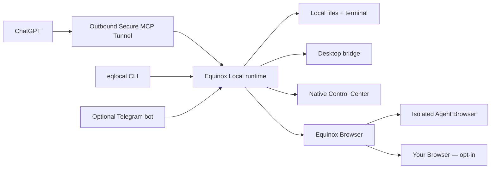

<div align="center">
  

  <p>A local-first bridge that lets ChatGPT work with your files, terminal, browser and desktop through a native Control Center and explicit user permissions.</p>

  [](https://local.sametbasbug.dev/install/)
  [](https://chromewebstore.google.com/detail/equinox-browser/npdneefcobilfkjlihghjgjnknenhfoj)
  [](https://github.com/sametbasbug/equinox-local/actions/workflows/ci.yml)
  [](LICENSE)
  

  **[Get started](https://local.sametbasbug.dev/install/)** · **[Features](#what-you-can-do)** · **[Installation](#install-equinox-local)** · **[Documentation](#documentation)** · **[Contribute](CONTRIBUTING.md)**
</div>

---

## What you can do

Equinox Local brings ChatGPT to your computer through an **outbound OpenAI Secure MCP Tunnel**. The native Control Center stays on your machine, and [Equinox Browser](https://chromewebstore.google.com/detail/equinox-browser/npdneefcobilfkjlihghjgjnknenhfoj) provides the only supported browser-automation bridge.

| Capability | What it does |
| --- | --- |
| **🗂️ Projects, files & terminal** | Explore and edit local files, work in repositories, run platform-appropriate shell commands, and manage bounded processes with your account's permissions. |
| **🌐 Two browser contexts** | Use a separately isolated **Agent Browser** by default, or explicitly allow **Your Browser** (your signed-in Chrome profile). No silent context switching. |
| **🖥️ Desktop automation** | Interact with approved desktop apps through the platform's native desktop bridge: Peekaboo on macOS and pinned Microsoft winapp on Windows. |
| **🔁 Long-running tasks** | Task Capsules, Auto Continue, Turn Budget and Fresh Chat Resume preserve checkpoints and support intentional continuation across ChatGPT conversations. |
| **💬 Optional Telegram** | Pair your own private bot, create or switch tasks, send messages to a chosen bound ChatGPT conversation, and receive task updates. |
| **⌨️ Agent CLI (`eqlocal`)** | Use the same authenticated local capabilities from a JSON-first terminal client: inspect status/tools, manage Task Capsules, and start/send/read/wait for task-bound chats. |
| **🛠️ Native Control Center** | Configure access, review status and diagnostics, manage tasks, use Emergency Stop, and install verified updates on macOS or Windows. |
| **🔐 Signed Main delivery** | Receive verified, source-SHA-specific native builds for four platform/architecture targets. The installed runtime and extension have separate update channels. |

> [!IMPORTANT]
> **Local-first is not a sandbox.** Enabling Terminal allows an agent to run commands with the permissions of your signed-in operating-system account, potentially outside configured project folders. Review the [security model](docs/security-model.md) and use Agent Access controls or Emergency Stop when appropriate.

## Install Equinox Local

### macOS — Apple silicon & Intel

Run as your normal user, **without `sudo`**:

```bash
curl -fsSL https://local.sametbasbug.dev/downloads/updates/install-equinox-local.sh | /bin/bash
```

### Windows — ARM64 & x64

Run in **native 64-bit Windows PowerShell** as your normal user (**no Administrator elevation**):

```powershell
irm https://local.sametbasbug.dev/downloads/updates/install-equinox-local.ps1 | iex
```

You can [inspect the official PowerShell installer](https://github.com/sametbasbug/equinox-local/blob/main/scripts/install-equinox-local.ps1) before running it, or follow the [Windows installation guide](https://local.sametbasbug.dev/install/).

Both installers download the **latest production-signed Main** for your platform, validate its signed identity and archive, and install only the product's program files. You do **not** need to preinstall Node, Git, Homebrew or compiler tools. Running the installer again is also the supported repair/reinstall path; existing user settings and personal data are preserved. The **Control Center Update** action uses the same signed OS installer; no separate Stable/Main enrollment is required.

After installing, open **Setup** to configure an OpenAI Secure MCP Tunnel and its restricted runtime key. Then open **ChatGPT → Plugins**, add your own custom MCP plugin using **Tunnel**, and install/enable Equinox Browser in Chrome. The onboarding flow checks the connection and access settings.

**Requirements:** macOS or Windows on ARM64/x64, Chrome, internet access, and a ChatGPT account. **Free and paid ChatGPT users can add custom MCP plugins directly from Plugins — no developer mode, extra setting or paid ChatGPT plan is required.** Equinox Local also needs a Secure MCP Tunnel and a restricted OpenAI Platform runtime key to connect. Telegram is optional. Read the [tunnel](docs/tunnel.md) and [browser setup](docs/browser.md) guides.

### Equinox Browser is installed separately

Get [Equinox Browser from the Chrome Web Store](https://chromewebstore.google.com/detail/equinox-browser/npdneefcobilfkjlihghjgjnknenhfoj). Consent and Browser Control are explicit per browser context. Chrome Web Store manages extension updates; **Equinox Local never sideloads or overwrites the extension**.

## Agent CLI

The `eqlocal` command communicates with the **already-running** Equinox Local process over a private, authenticated local IPC bridge. It does not start a second AI agent or run a second web server. Managed macOS/Windows installations provision the CLI; macOS Factory/source-checkout runtimes provision a launcher for their existing local runtime too.

```bash
# Inspect your connected runtime and its tools
eqlocal status
eqlocal tools list

# Read the complete CLI interface
eqlocal --help
```

The CLI also supports Task Capsule operations and guarded task-bound ChatGPT messaging. See the [CLI guide](docs/cli.md) for commands, JSON argument handling, and platform-specific shell behavior.

## How it works



- **Local management:** Control Center is served on private loopback; runtime capabilities are subject to your configured access and product guards.
- **Separate browser identities:** Agent Browser and Your Browser maintain independent profiles and consent. Your personal Chrome is never an implicit fallback.
- **Resumable actions:** Task continuation preserves state without automatically repeating a chat send whose result is uncertain.
- **One signed Main channel:** A completed four-target Main build is published as immutable source-SHA native artifacts and an Ed25519-signed latest selector. The native installer verifies this before replacing program files. Main presentation version and exact source commit are distinct; changes can ship without a new numbered GitHub Release.
- **Independent extension lifecycle:** the Chrome Web Store owns Equinox Browser review, publication and automatic updates.

## Documentation

| Guide | What you'll find |
| --- | --- |
| [Install & connect](https://local.sametbasbug.dev/install/) · [Tunnel](docs/tunnel.md) | Onboarding, supported platforms and ChatGPT connection |
| [Equinox Browser](docs/browser.md) | Agent Browser / Your Browser, permissions and context separation |
| [Agent CLI](docs/cli.md) | JSON-first local CLI, tools, tasks and Chat Bridge |
| [Telegram & tasks](docs/telegram.md) | Optional private bot, task creation and conversation binding |
| [Architecture](docs/architecture.md) | Runtime design, control plane, native platforms and signed source identity |
| [Updates](docs/updates.md) | Signed Main, reinstallation, security verification and recovery |
| [Security](docs/security-model.md) · [Report vulnerabilities](SECURITY.md) | Capability boundaries and responsible disclosure |
| [Contributing](CONTRIBUTING.md) · [Changelog](CHANGELOG.md) | Development workflow and release history |

## For developers

This repository is the **canonical public source** for Equinox Local, Equinox Browser, native macOS/Windows shells, the product website (`website/`) and release tooling. Private Factory configuration and signing credentials live outside the repository; the Mac Factory source checkout is not a public managed installation.

```bash
git clone https://github.com/sametbasbug/equinox-local.git
cd equinox-local
npm ci
npm run check
```

See [CONTRIBUTING.md](CONTRIBUTING.md) for supported Node tooling, platform prerequisites and contribution guidelines. Use [issues](https://github.com/sametbasbug/equinox-local/issues/new/choose) for bugs and the [private security channel](SECURITY.md) for vulnerabilities.

## License

Equinox Local and Equinox Browser are licensed under **[AGPL-3.0-only](LICENSE)**. See [CONTRIBUTING.md](CONTRIBUTING.md) and [CODE_OF_CONDUCT.md](CODE_OF_CONDUCT.md).
