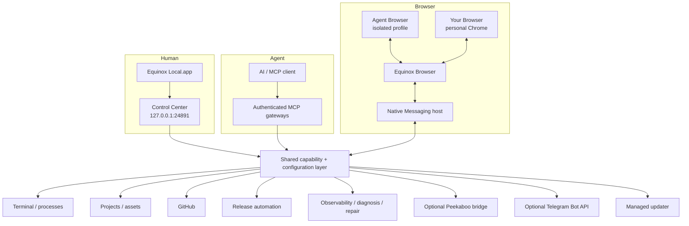

# Architecture

Equinox Local is a per-user **macOS and Windows** runtime that exposes local capabilities to AI clients while providing a native Control Center backed by a private loopback management service. Native shells and process supervision follow each platform’s lifecycle rules.

## Repository and installation ownership

`sametbasbug/equinox-local` is the single canonical product source: runtime, native/platform code, installers, website, documentation and product CI/CodeQL live here. Ordinary feature/fix and contributor PRs target canonical `main` without generating another source tree.

Private factory/ops orchestration is an external client of a clean canonical checkout and exact SHA. The public runtime's private-composition loader keeps a safe generic default; an explicitly configured, admitted external module may supply factory-only hooks without a public import back into private tooling. Private config, signing/provider/tunnel secrets and durable user state remain outside tracked source. Factory is an installation/profile role, not a second mutable product implementation.

The current public installer and the Control Center Update action use **one external signed Main installer**, on both macOS and Windows. The installer verifies an Ed25519-signed four-target selector and the exact SHA-256/byte count of the selected immutable native artifact, admits its canonical source identity and reinstalls **only product program files**. It preserves per-user configuration, tunnel keys, workspace and browser state. A displayed version and signed source SHA are different identities: multiple signed Main commits can share one numbered presentation version. The same installer can be rerun for repair; there is no required Stable-to-Main enrollment or separate updater engine.

Canonical `main` CI produces the four native targets (`darwin-arm64`, `darwin-x64`, `win32-arm64`, `win32-x64`) before the protected signer publishes an atomic production Main selector. Exact-SHA R2 native snapshots are retained for the latest three complete groups, plus any still-authoritative `main`, `main-snapshot` and signed-current references. The janitor runs after successful Main publishing, with a daily fallback. Docs/metadata-only changes do not claim a new native runtime. The public GitHub numbered Release and the exact signed Main SHA have distinct roles.

A macOS Factory/source-checkout installation is a **separate development role**, using the same canonical code but an explicitly configured source launcher rather than the public managed-native installer. It must not be replaced by a signed public release on the maintainer's Mac mini. Factory-only secrets/configuration remain outside the repo. See [updates](updates.md) and [the consolidation record](plans/one-main-one-installer-one-repo.md).

## Main surfaces

The human UI and agent surface intentionally converge on the same configuration and operation layer rather than implementing separate privileged backends.

## Configuration

Machine-specific project roots live outside the repository in the user's Equinox Local configuration. The loaded registry defines:

- projects and their filesystem-root shortcuts;
- read-only extra file roots;
- Agent Access (`files: full|selected`, Terminal/process, Desktop and Browser switches);
- the default project;
- the managed workspace project;
- the downloads root; and
- Control Center enablement/port.

Fresh managed configs explicitly seed Full Agent Access. Existing configs that predate `agentAccess` normalize to selected-root filesystem behavior so an update does not silently widen prior boundaries. The configuration parser rejects unknown fields, unsafe IDs, duplicate configured roots, filesystem-root configuration, non-boolean capability switches and unsupported writable extra roots.

## Stable MCP surface

The top-level MCP API stays intentionally small: one read-only `capabilities` discovery tool plus semantic call gateways for runtime, files, browser, desktop, release/deployment and integrations. The Files domain publishes an explicit routing hint: for Mac-local PNG/JPEG/WebP visual inspection, prefer `image_view` directly and do not use `file_export`/container-copy as an inspection workaround. `capabilities` lists domains, supports bounded keyword search, and returns exact live operation schemas on demand. Operation schemas are validated at invocation time, while the underlying operation handler retains its original project context, mutation locks, path guards, and error semantics.
The Files gateway is registered as a raw MCP gateway so multimodal/resource content survives end-to-end; other stable semantic gateways keep the text-normalized contract.

This keeps the public connector surface at seven tools while allowing the runtime to gain new operations without turning every operation into a permanently cached top-level MCP schema. Browser operations use short agent-facing aliases (`snapshot`, `click`, `wait`, etc.); desktop status/refresh/restart are explicit `desktop_call` operations rather than hidden discovery flags.

## Terminal, project discovery, and GitHub

Root-aware structured capabilities resolve through the active Agent Access file mode. Selected mode uses configured roots; Full mode can use configured IDs, `home`, or an accessible absolute folder as the active contained root. Direct filesystem-root access and protected credential/application-secret areas are blocked for ad-hoc Full roots, and traversal/symlink escape is rejected in both modes. The retained Files gateway is limited to project/root discovery. Terminal/process is the terminal-first path for ordinary local file/repo/Git/GitHub/package-manager work and intentionally follows the logged-in operating-system user's permissions; once a shell starts it is not confined to Selected roots. Generic execution environments are sanitized so Equinox-managed provider credentials are not inherited; GitHub PR/Actions work may use the user’s separately authenticated system-keyring `gh` CLI without token injection. `terminal_exec` starts each command once through the platform-selected finite shell (`/bin/zsh -lc` on macOS; noninteractive PowerShell 5.1 by default on Windows, with explicit optional PowerShell 7 `shell: "pwsh"` when separately installed (no PATH lookup or bundled installer)) under the managed-process lifecycle: it waits for a bounded foreground response window, preserves stdout/stderr plus observed combined ordering, and returns the same process ID/cursor when work continues instead of killing or restarting it. Explicit long-lived non-PTY servers/watchers may start directly with `process_*`. Interactive sessions keep their platform shell semantics. On macOS, Local tracks the controlling TTY's owned jobs so explicit stop/shutdown can drain jobs that zsh placed into separate process groups; on Windows, the ConPTY session and descendants are owned by the accepted Job Object lifecycle instead. Windows terminal gates stay hidden from the user desktop, and interactive sessions remain inside their owned ConPTY.

Ordinary local Git/worktree/GitHub commands run through Terminal and follow repository policy rather than a dedicated Git wrapper surface. `gh` may use the user's system-keyring authentication, while Equinox-managed provider credentials remain outside generic Terminal. The Control Center management API exposes no arbitrary Git or shell endpoint.

## Equinox Browser

Equinox Browser is the only product browser transport. It serves two explicit Chrome contexts behind the same extension, Native Messaging host and local bridge: **Agent Browser** is the default isolated Equinox Local profile (`target=agent`), while **Your Browser** is the user's personal Chrome profile and must be selected explicitly (`target=user`). The two contexts keep independent Chrome/profile state and Equinox Local never silently falls back from one to the other.

Browser-control consent and the on/off state live independently in each extension profile. Equinox Local cannot silently enable control before the current disclosure has been accepted. Agent Browser bookmark automation is intentionally isolated to `target=agent`; Your Browser bookmark calls fail closed before the bridge and in the extension. The extension popup also owns a profile-local Auto Continue target choice; explicit pins are human-selected and a stale pin never falls back to another tab/profile.

The retired loopback/CDP QA browser is not part of the product architecture. Release and visual QA use the same first-party Agent Browser extension/Native Messaging lane rather than a second isolated browser backend.

## Task continuity

Equinox Local stores bounded durable **Task Capsules** under its managed workspace rather than duplicating ChatGPT transcripts. A capsule contains the current task objective, completed and next steps, safe references, status, checkpoint revision and bounded continuation metadata. The store defaults to a 50-capsule retention ceiling: capacity pressure prunes only the oldest terminal (`completed`/`cancelled`) records, while active work is never evicted. Checkpoint replacement is atomic and revision guarded so stale human edits cannot overwrite a newer agent checkpoint.

**Auto Continue** is an explicitly armed one-shot transition, not an autonomous loop. Each hop binds immutable Browser context/instance/tab/conversation/user-epoch/assistant-turn identity, has a TTL, and requires a new explicit arm after delivery; automatic chains default to 10 hops and expose a bounded 1–20 Control Center setting. Armed state can be reconciled after a Local runtime restart, while a persisted in-flight delivery is treated as ambiguous and never blindly retried. Human composing/new input, explicit cancellation, target drift and Emergency Stop retire pending arms.

**Fresh Chat Resume** moves the same durable Task Capsule to one fresh ChatGPT conversation without storing or copying the transcript. Root/project identity is verified before rebinding, Local persists `prepared`/`creating`/`confirmed`/`ambiguous` transition state, and the Browser extension claims a bounded receipt before creating the destination. Only a pre-mutation `prepared` transition is resumable after restart; in-flight uncertainty is fail-closed and never automatically retried. Control Center exposes fixed cancel/abandon recovery actions for prepared/ambiguous transitions, with no generic retry endpoint.

## Control Center

The sidebar remembers the last section the human explicitly opened on this device. A URL's validated `section` or `task` navigation intent overrides that preference, while first-time Setup still takes precedence. Option/Alt + Shift + number 1–7 provides quick section switching, but never captures keystrokes from an input/editor, an open dialog or Setup mode. Only a bounded `GET /` HTML navigation URL may include `section`/`task` parameters; API and mutation URLs continue to reject query parameters. These are presentation conveniences, not new agent capabilities or permission grants.

The human entry point is a platform-native shell rendering the same private-loopback Control Center at `127.0.0.1:24891`: AppKit/WKWebView on macOS and WPF/WebView2 on Windows. Windows merges trusted Machine/User PATH sources and supports stock PowerShell or an explicitly selected PowerShell 7. Both shells remain presentation/lifecycle hosts over a single local backend, not separate management servers.

Turn Budget measures ChatGPT generation from the Equinox Browser content observer; when observer identity is unavailable, the fallback uses the first Local tool call and returns to Idle after its configured inactivity window. Auto Continue and Fresh Chat Resume use explicit, bounded state rather than blindly resending uncertain operations. The runtime checks its signed Main update channel after startup and periodically; a failed check is reported as unknown/attention, never silently as "up to date". Control Center's Update button invokes the same production-signed external installer as the public command-line installer. The Windows Guardian validates existing signed native identity at startup; it does not act as a separate update engine. Factory/source checkouts do not self-update to public Main.

The Control Center backend exposes fixed same-origin management routes, not arbitrary file or shell execution. Task Capsules have bounded list/detail and guarded state transitions; permanent delete requires an eligible terminal state. Ambiguous actions do not automatically replay browser mutations. Settings and task changes are validated by same-origin, CSRF and revision guards.

Optional service integrations keep credentials outside the public configuration surface. Telegram uses explicit private-user pairing instead of requiring a manually typed Telegram ID: Control Center validates the BotFather token, begins a bounded pairing session, discovers only a private `/start` candidate and requires the human to confirm that account before the credential is persisted. Group/channel candidates and all updates from unpaired users are rejected. Pairing state, credentials, the bounded inbound queue and task-message routing journal are private local state protected by the platform private-state contract (`0600` files on macOS; current-user protected ACLs on Windows); persisted next-update/action records prevent replay across Local restarts. Network-derived pairing/inbox records are canonicalized through the same bounded schema before persistence and again after readback; malformed persisted entries fail closed rather than becoming trusted local state.

The agent surface has bounded `telegram_send_message` and `telegram_send_file` operations—there is no generic agent-facing Telegram inbox/read operation. File sending keeps the paired recipient fixed and reuses the normal Local file-export access policy. The paired human also gets a bounded Telegram Remote Control surface: `/status`, `/tasks`, `/chat`, `/unbind` and `/help` are registered only for that private chat. A default-on Control Center switch can disable this inbound remote-control surface without disabling outbound Telegram delivery; while disabled, updates are consumed and discarded rather than queued for later execution. Browser-bound active assistant turns refresh Telegram's short-lived `typing` action through the same inbox cycle. Bound chat cards expose **↗ Open in ChatGPT** plus **🔌 Unbind**; the callback is exact-message scoped and shares the same cleanup path as `/unbind`. `/status` creates short-lived exact-message controls for Emergency Stop/Resume and runtime Restart. Emergency Stop and Restart use action-specific expiring confirmations and the same shared Agent Control/restart services as Control Center.

Telegram Chat Bridge is Task-scoped. A Task must still be active at bind time and before every new bridged mutation; completed/cancelled Tasks auto-unbind after any pending final response settles and cannot be rebound, though their Open in ChatGPT link remains available.  `/tasks` opens controls for every active Task Capsule; verified Task conversations can then be explicitly selected for chat while preserving `task_id`; a normal unbound Telegram message never guesses or creates a ChatGPT target and instead asks the human to select a Task. `/tasks` also exposes an explicit **New task** action: the next Telegram text becomes the Task objective, Local creates the Task Capsule, opens one root ChatGPT conversation, confirms it, and binds that exact conversation to the new Task. No implicit target search, project picker, or cross-profile fallback is allowed.

One Telegram photo/document may be downloaded once into the configured user-visible Telegram folder. Chat Bridge does not create an opaque resolver protocol around that file: Task-bound turns send only user text + `task_id` + optional exact `local_file`; there is no taskless Chat Bridge mode. The agent chooses whether the path needs visual inspection, document reading, local move/copy, or no file access at all. Browser-side re-upload is absent. Task-card replies remain a separate Task Capsule `humanInput` path with opaque attachment metadata and exact-task `telegram_attachment_open`.

Chat Bridge v9 keeps a separate delivery-receipt namespace and debugger-backed state lane. Bound-chat delivery uses guarded `Input.insertText`, waits for a real enabled send button, performs trusted pointer submission, and confirms a new user epoch. Fresh chats use generic Browser create/snapshot/type/URL-confirm primitives, then allow `previousAssistantTurnKey=null` only for reading the first final assistant response. Local persists one pending bridge turn, writes `sending` before Telegram output, and converts restart/send/browser uncertainty to terminal ambiguity rather than replaying.

A dedicated internal Telegram task inbox controller maps one bot message to one Task Capsule, edits the same card as the task changes and accepts only callbacks whose short route token **and** originating Telegram message ID match that mapping. Active cards include a bounded next-step hint; terminal updates edit the same card, remove mutation controls and show the finished timestamp rather than emitting another lifecycle message. Replies to a mapped card become one bounded `humanInput` record on the Task Capsule. Normal task checkpoints clear the consumed pending input. Task checkpoints also best-effort capture a private exact ChatGPT conversation binding; Telegram Continue/reply routing can then reuse Auto Continue's exact-tab/conversation/turn delivery guards even when that conversation is idle. If a Telegram action is interrupted after durable reservation, restart marks it ambiguous and never automatically replays the mutation. A mapped task reply can include one photo/document: metadata stays bounded in the update journal, payload download uses Telegram `getFile` only after exact task-message mapping, and files are stored in a configurable user-visible download folder that defaults to `~/Downloads/Equinox Local/Telegram/`. Download-location settings keep a bounded history of prior roots so changing the destination affects only future files without breaking existing Task Capsule attachments; user-visible downloads are not auto-deleted. Public task state exposes an opaque attachment id rather than the storage path. `telegram_attachment_open` requires that opaque id plus the exact task and can only open the current pending human-input attachment.

## Managed installation

A public managed Main install is per-user and identified by a **signed native source SHA**, not solely the displayed version. A private, validated native-store release/pointer determines the active program payload; macOS LaunchAgent supervision and the stable `Equinox Local.app` shell launch it, while the Windows per-user WPF shell supervises Node using Job Object ownership. Equinox Browser's Native Messaging host is registered to the active managed release. The browser extension itself is updated exclusively by the Chrome Web Store.

On install, repair or Update, the external Bash/PowerShell installer downloads the production-signed latest Main artifact, verifies exact bytes and native identity, retires only owned executable roots, then requires a matching healthy release receipt. User settings, workspace and secrets are never wiped as part of the update. Windows stages detached installation outside the app's process Job Object, retaining installer logs for diagnostics. macOS separates public launchd supervision from the maintainer's source-checkout Factory runtime. Historical Stable/A-B plans are not current alternatives. See [updates](updates.md).

## Observability and recovery

Runtime events are bounded, rotated, and sanitized before persistence. Diagnosis converts correlated evidence into explicit incidents. Repair recipes and automatic recovery policies are fixed operations with ownership/health guards; they are not arbitrary commands generated from model output.

## Internal module boundaries

The composition root in `src/server.js` delegates tool registration to `equinox-local-tool-registration.js` and workspace directory preparation to `equinox-local-workspace-runtime.js`. Registration shares restart, pause and replay plumbing while retaining separate text/raw adapters: text operations keep project context, mutation scopes and text normalization; raw operations preserve multimodal content and do not acquire an implicit additional lock.

- `runtime-history-store.js` owns the repair/janitor JSONL read/retain/write mechanics; each caller retains its domain validation and query semantics.
- `equinox-control-center-localization.js` contains the language catalog and pure translators. The DOM entrypoint remains `equinox-control-center.js`; both are served through explicit same-origin asset routes, and release packaging traverses the UI import graph.
- `equinox-browser-artifacts.js` owns PDF snapshot enrichment and screenshot storage/integrity/quota helpers; tool routing and Browser-context guards remain in `equinox-browser-tools.js`.
- The Chrome Web Store classic MV3 worker is authored in strict `extension/service-worker.ts` and emitted as `extension/service-worker.js`. It is built separately from the popup and content-script TypeScript sources to preserve their independent classic-script globals; `npm run verify:typed-browser` checks all four emitted files byte-for-byte. The classic worker loads `extension/bookmarks.js` with `importScripts`; the bookmark capability retains the Agent Browser-only boundary and existing rollback behavior. Only the generated JavaScript and existing runtime assets enter the explicit extension ZIP allowlist.
- `equinox-local-darwin-helper-environment.js` shares the minimal macOS detached-helper environment, while Windows keeps its platform-specific policy. `equinox-local-release-tree.js` shares bounded tree validation without combining first-install/update lifecycle orchestration.
- `scripts/lib/factory-tooling.mjs` shares source/test discovery and subprocess mechanics with explicit caller policy. `scripts/lib/package-io.mjs` shares streamed hashing. Extracted lifecycle-sensitive helpers retain the required production-upgrade-smoke classification.

These are internal boundaries, not new MCP operations, configuration keys or management endpoints. Native shells, process ownership and release/signing flows remain separate platform responsibilities.

## What is intentionally not part of the public product

- private Equinox deployment profiles;
- maintainer-specific project integration wiring;
- retired legacy QA Chrome backends or alternate browser transports;
- generic shell/command management endpoints;
- a fallback into user Chrome outside Equinox Browser.

## Canonical signed Main distribution (implemented)

The maintainer has approved one canonical public repository, signed Main-SHA packages independent of manually numbered Releases, and one external installer invoked identically by Control Center and terminal. The Astro website source and Cloudflare production Builds now run from this public repo’s `website/` (same existing Worker, unchanged custom domain, live route and signed-manifest parity verified on 2026-10-27). The former separate website repository has been retired; the canonical `website/` directory deploys the existing Cloudflare Worker. Protected Main builds and independent per-architecture signatures/verification are operational. The historical implementation checkpoints live in [`plans/one-main-one-installer-one-repo.md`](plans/one-main-one-installer-one-repo.md); Factory configuration stays private.

### Private Factory developer runtime

The Mac mini Factory installation is a **live source development role**, not an immutable/public Main installation. When the private developer configuration has both `privateCompositionModule` and a `sourceLauncher` referencing the active checkout’s `scripts/release/start-main-source-runtime.sh`, the launcher runs `src/server.js` and supporting scripts directly from that checkout, including locally edited code before a commit/PR/CI/release. The existing `restart_runtime` operation reloads that same checkout. The private composition, tunnel, credentials and workspace remain outside the public Git tree. For consumers without this private configuration, the authenticated SHA source pointer remains unchanged. No test files are authored.

## Agent-first CLI

The `eqlocal` CLI is a client of a local, token-authenticated IPC bridge inside the existing runtime. The server delegates `tools.*` calls to the same capability registry and desktop handler as MCP, `tasks.*` to Task Capsules, and `chat.*` to the existing exact-conversation Browser Chat Bridge. CLI-created chats use a neutral READY handshake by default (explicit `--run-task` opts in to Telegram-style immediate Task objective execution), preventing surprise recursive agent starts without changing Telegram's contract. No extra HTTP listener, browser backend, AI model or shell management route is introduced. The CLI discovery descriptor belongs to user-private application state and is regenerated on runtime startup. Managed-install shims use pinned Node with owned PATH/uninstall cleanup. Signed Main runtimes reconcile the CLI launchers to their own reauthenticated native release after startup only when the signed update-owner marker is gone, so updates and rollbacks need no new A/B mutation pathway. macOS Factory/source-checkout runtime startup also reconciles a user-owned `~/.local/bin/eqlocal` launcher using the running source CLI and resolved Node executable, without requiring or claiming a signed managed release. The current source and installed-runtime CLI launchers are available without a separate agent process; see [CLI docs](cli.md) for syntax and device notes.
